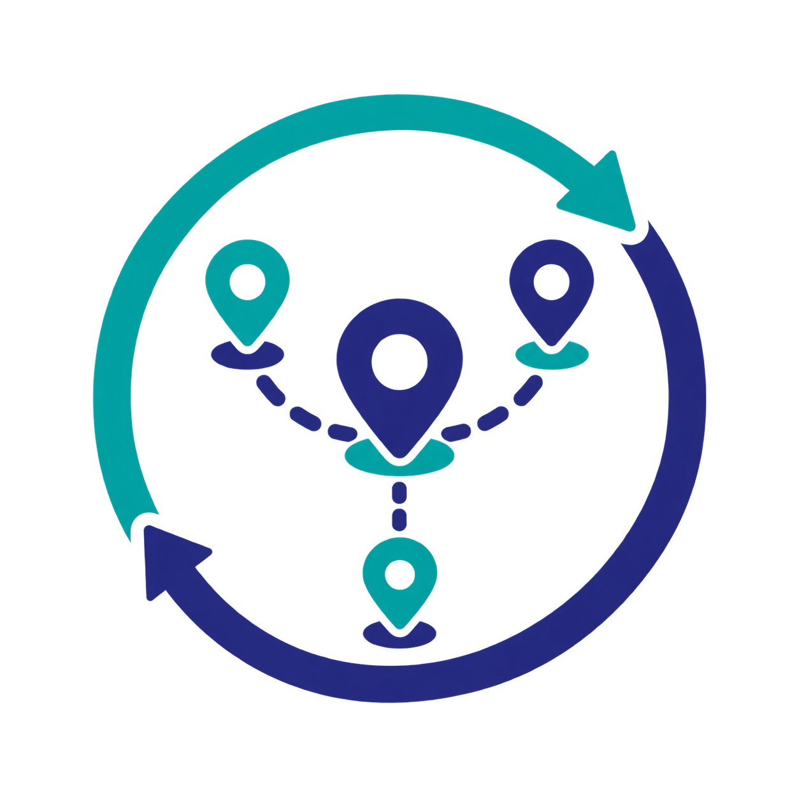

<h1 align="center">
  
  Treasure Hunt
</h1>

<h4 align="center">Team, QR scan, solve, progress, and leaderboard flows in Recon.</h4>

  

  <a href="#feature-flow">Feature Flow</a> •
  <a href="#api-routes">API Routes</a> •
  <a href="#state-and-ranks">State and Ranks</a>

  <a href="#how-to-use">How to Use</a> •
  <a href="#license">License</a>

The repository has no screenshot from a verified run. This README omits QR images and answer data.

## Feature Flow

1. A participant creates a team or joins one with an invite code.
2. The service resolves a QR token to one active problem for the participant's team.
3. The service checks a submitted answer against stored data.
4. The service records a solve and updates team progress.
5. Participants can view progress, the leaderboard, and the limited finisher list.

A participant can belong to one team. Team creation uses the current team model.

## API Routes

| Method | Route | Purpose |
| --- | --- | --- |
| POST | `/api/v1/teams/` | Create a team and add its creator |
| POST | `/api/v1/teams/join` | Join a team by invite code |
| GET | `/api/v1/teams/me` | Read the caller's team and roster |
| GET | `/api/v1/treasure-hunt/scan/{qr_token}` | Resolve a QR token to an active problem |
| POST | `/api/v1/treasure-hunt/problems/{problem_id}/submit` | Submit an answer for validation |
| GET | `/api/v1/treasure-hunt/me/progress` | Read team progress, solved problems, rank, and finisher slot |
| GET | `/api/v1/treasure-hunt/leaderboard` | Read team rankings |
| GET | `/api/v1/treasure-hunt/finishers` | Read the first four completion slots |

## State and Ranks

Solve writes are not batched. The service records a solve and updates progress in one transaction.

The leaderboard sorts by solved count, then completion time, then last solve time. The service keeps a progress row per team for leaderboard reads.

The source documentation says a user interface can poll the leaderboard every three to five seconds. It warns against grouped solve writes.

## How to Use

Start with the [backend guide](../../recon-backend/README.md) and [frontend guide](../../recon-frontend/README.md). Read the [frontend feature specification](frontend_spec.md) before you change the flow.

Set the live API host before you create event QR assets. The host shown in the source README is an example host. Replace it for a live event.

## License

The repository has no root `LICENSE` file. See the [root README](../../README.md) for the current legal note.

---

  <a href="../../README.md">Recon overview</a> •
  <a href="../../recon-backend/README.md">Backend guide</a> •
  <a href="../../recon-frontend/README.md">Frontend guide</a>

